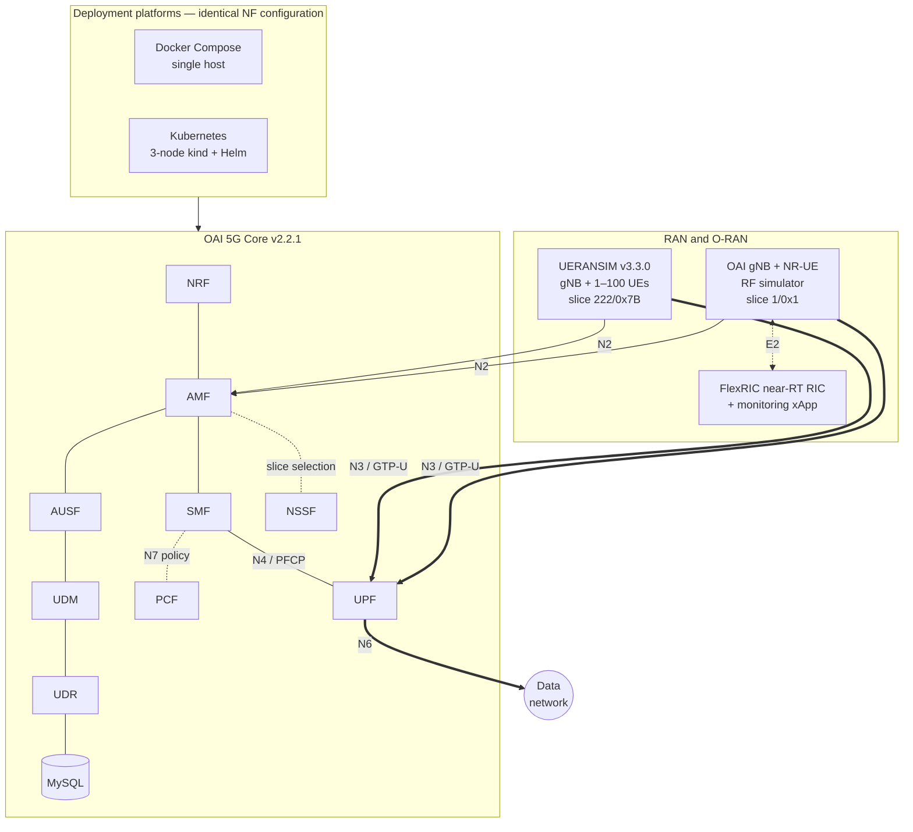
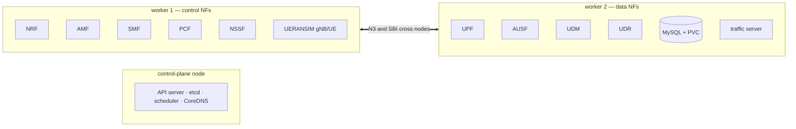
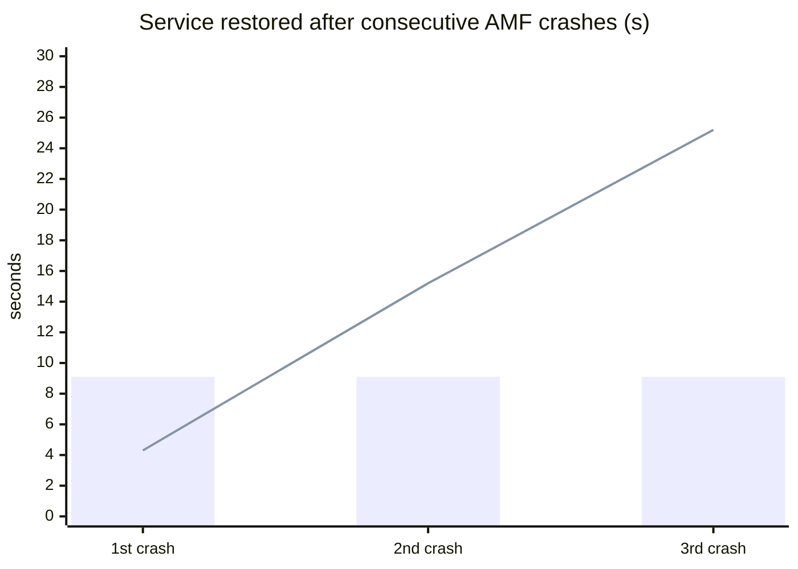
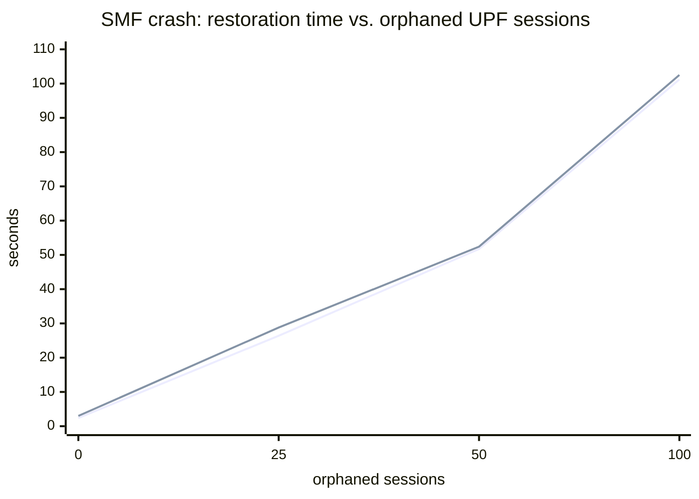
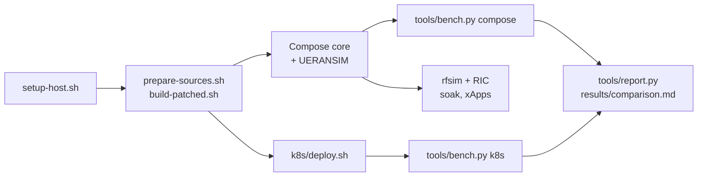

<div align="center">

# Cloud-Native Softwarization of an Open-Source 5G Core Using Docker, Kubernetes, UERANSIM, and OAI

**A reproducible 5G Standalone + O-RAN testbed that runs on a single laptop.**<br>
The same OpenAirInterface 5G core is deployed with **Docker Compose** and on a **3-node Kubernetes** cluster,
validated with **UERANSIM** and a real **OAI gNB + NR-UE**, monitored by an **O-RAN near-RT RIC (FlexRIC)**,
and benchmarked side by side with one harness.


[What is this?](#what-is-this) ·
[Architecture](#architecture) ·
[Quick start](#quick-start) ·
[Results](#results) ·
[OAI issues found](#issues-found-in-the-oai-software) ·
[Reproduce](#reproduce-every-number) ·
[Layout](#repository-layout)

</div>

---

## What is this?

5G networks are now built from software: the **5G core** is a set of microservices (network functions,
NFs) that talk to each other over HTTP/2. That makes it possible to run a complete mobile network in
containers — but how does the *same* core behave on different container platforms, how does it fail, and
what does it cost to run?

This repository answers those questions with a testbed you can rebuild yourself:

| | What you get |
|---|---|
| **5G core** | OAI CN5G v2.2.1 — NRF, AMF, SMF, UPF, AUSF, UDM, UDR, **PCF**, **NSSF** + MySQL, two network slices, 101 subscribers |
| **Platform A** | Docker Compose on one host, health-gated start-up |
| **Platform B** | 3-node Kubernetes cluster (kind) deployed from one Helm chart that mounts the **identical configuration** |
| **RAN** | UERANSIM (1–100 emulated UEs) **and** a containerized OAI gNB + NR-UE (RF simulator) |
| **O-RAN** | FlexRIC near-RT RIC connected to the gNB over **E2**, with a MAC/RLC/PDCP/GTP monitoring xApp |
| **Benchmarks** | One harness for both platforms: attach time, 1–100 UEs, latency, throughput, CPU/RAM, crash recovery |
| **Findings** | 10 issues in the OAI software, 4 fixed with patches included here |

> Everything runs on a laptop with **5 GiB RAM** (AMD Ryzen 5 5500U, Ubuntu 26.04 LTS).

---

## Architecture



<details>
<summary><b>How the NFs are placed on the 3-node Kubernetes cluster</b></summary>



* Headless services → NF names resolve to pod IPs through CoreDNS (like container names in Compose)
* Init containers → every NF waits for the NRF
* Readiness probes poll every 3 s (same interval as the Compose health checks)

</details>

---

## Quick start

> **Requirements:** Ubuntu 22.04+ (tested on 26.04), 4+ cores, ≥ 5 GiB RAM (+ swap), ~20 GB disk, internet access.

<details open>
<summary><b>Step 1: Prepare the host (once)</b></summary>

```bash
git clone https://github.com/SHAHEER-D/Cloud-Native-Softwarization-of-an-Open-Source-5G-Core-Using-Docker-Kubernetes-UERANSIM-and-OAI.git oai-testbed
cd oai-testbed
sudo bash setup-host.sh          # Docker, Compose, SCTP module, IP forwarding, extra swap
# log out and back in so your user can run docker without sudo
```

For Kubernetes you also need `kind`, `kubectl` and `helm` in your `PATH`.

</details>

<details>
<summary><b>Step 2: Build the patched AMF and PCF images (~1 h on a laptop)</b></summary>

```bash
build/prepare-sources.sh         # clone OAI AMF/PCF v2.2.1 and apply patches/
build/build-patched.sh           # -> testbed/oai-amf:v2.2.1-fix, testbed/oai-pcf:v2.2.1-fix
```

Why? Without the patches the AMF cannot register with the NRF when the NSSF is enabled, and the PCF
never sends heartbeats (see [issues](#issues-found-in-the-oai-software)).

</details>

<details>
<summary><b>Step 3: Run the 5G core with Docker Compose + UERANSIM</b></summary>

```bash
docker compose -f core/docker-compose.yaml up -d --wait          # 11 containers, ~54 s
NUM_UE=1 docker compose -f ueransim/docker-compose.yaml up -d --build
docker exec ueransim-ue ping -I uesimtun0 192.168.70.135          # UE -> gNB -> UPF -> data network
```

Try 100 UEs at once: `NUM_UE=100 docker compose -f ueransim/docker-compose.yaml up -d --force-recreate ueransim-ue`

</details>

<details>
<summary><b>Step 4: Run the OAI gNB + NR-UE (RF simulator)</b></summary>

```bash
docker compose -f rfsim/docker-compose.yaml up -d
docker exec oai-nr-ue ping -I oaitun_ue1 192.168.70.135
tools/soak_rfsim.sh 1800          # 30-minute stability test
```

</details>

<details>
<summary><b>Step 5: Add the O-RAN near-RT RIC (FlexRIC) and xApps</b></summary>

```bash
docker compose -f rfsim/docker-compose.yaml down
docker compose -f rfsim/docker-compose-ric.yaml up -d                     # RIC + E2-enabled gNB + NR-UE
docker compose -f rfsim/docker-compose-ric.yaml --profile xapps up -d     # KPM and MAC/RLC/PDCP/GTP xApps
docker logs -f xapp-l2
```

</details>

<details>
<summary><b>Step 6: Run the same core on a 3-node Kubernetes cluster</b></summary>

```bash
docker compose -f ueransim/docker-compose.yaml down; docker compose -f core/docker-compose.yaml down
k8s/deploy.sh                     # kind cluster + Helm chart + UERANSIM, ~17 s once images are cached
kubectl -n oai get pods -o wide
```

Tear down: `k8s/deploy.sh teardown`

</details>

<details>
<summary><b>Step 7: Benchmark both platforms</b></summary>

```bash
python3 tools/bench.py compose                 # attach, load, latency, tput, resources, recovery, stale
python3 tools/bench.py k8s
python3 tools/report.py                        # -> results/comparison.md
```

Single tests: `python3 tools/bench.py k8s attach latency --reps 5`

</details>

---

## Results

Measured on one laptop (Ryzen 5 5500U, 5 GiB RAM) with the same configuration on both platforms.
The raw measurements behind every number are in [`results/`](results/); [`tools/report.py`](tools/report.py) rebuilds the comparison from them.

| Metric | Docker Compose | Kubernetes (3 nodes) |
|---|:---:|:---:|
| UE attach success (20 tries) | 20/20 | 20/20 |
| Registration time, median | 38 ms | 30.5 ms |
| PDU session setup, median | 220 ms | 224.5 ms |
| RTT UE → data network | 1.40 ms | 1.72 ms |
| TCP uplink / downlink | 220 / 236 Mbit/s | 222 / 189 Mbit/s |
| Cold start of the whole core | **54 s** | **17 s** |
| 100 simultaneous UEs | 100/100 in 3.5 s | 100/100 in 4.0 s |
| Memory of the whole core | 259 MiB | 267 MiB |
| Recovery after 1st NF crash (AMF) | 9.1 s | **4.3 s** |
| Recovery after 3rd consecutive crash (AMF) | **9.1 s** | 25.2 s |


<sub>Bars: Docker Compose (constant). Line: Kubernetes — faster on the first crash, then slowed by CrashLoopBackOff.</sub>

<details>
<summary><b>Scalability: 1–100 simultaneous UEs</b></summary>

| UEs | Compose: all attached after | Compose: per-UE median | Kubernetes: all attached after | Kubernetes: per-UE median |
|---:|---:|---:|---:|---:|
| 1 | 0.28 s | 285 ms | 0.25 s | 251 ms |
| 10 | 2.79 s | 241 ms | 2.66 s | 234 ms |
| 25 | 2.62 s | 578 ms | 2.69 s | 578 ms |
| 50 | 2.66 s | 1163 ms | 2.74 s | 1202 ms |
| 100 | 3.45 s | 2124 ms | 4.04 s | 3375 ms |

100 % success on both platforms at every step.

</details>

<details>
<summary><b>Crash recovery and orphaned sessions</b></summary>

Time until a new UE gets a PDU session after the NF is killed (SIGKILL), three consecutive crashes:

| Crashed NF | Docker Compose | Kubernetes |
|---|---|---|
| AMF | 9.1 / 9.1 / 9.1 s | 4.3 / 15.2 / 25.2 s |
| SMF | 8.5 / 8.6 / 8.6 s | 4.4 / 18.7 / 30.8 s |
| UPF | 8.7 / 8.7 / 23.3 s | 9.5 / 19.9 / 36.0 s |
| NRF | 8.6 / 8.6 / 10.2 s | 20.3 / 31.4 / 43.3 s |

If the SMF crashes while the UPF still holds sessions of UEs that disappeared without deregistering,
every orphaned session costs about **one second** of outage — on both platforms:


<sub>Docker Compose and Kubernetes lines overlap: the penalty comes from OAI, not from the platform.</sub>

</details>

<details>
<summary><b>OAI gNB stability and O-RAN monitoring</b></summary>

**30-minute soak test** of the containerized OAI gNB + NR-UE (RF simulator, stock kernel):

| Pings answered | Packet loss | RTT median / p95 | Container restarts | iperf3 DL runs |
|---|---|---|---|---|
| 1799 / 1799 | 0 % | 22.2 / 35.8 ms | 0 | 6 / 6 (26–40 Mbit/s) |

**Long run:** in a later run the same gNB and NR-UE containers (attached to the RIC) stayed up for
**5 h 51 min with 0 restarts** of any core, RAN or RIC container; a final check found 300/300 pings answered
(RTT median 15.8 ms, p95 22.6 ms) and 34.7 Mbit/s TCP downlink. Raw data: [`results/rfsim-longrun/`](results/rfsim-longrun/).

**FlexRIC near-RT RIC over E2:** the gNB exposes 9 RAN functions. With exactly **10.0 Mbit/s** of injected
downlink traffic, the RIC-measured MAC throughput was **10.39 Mbit/s** (the extra 3.9 % is protocol overhead).

| E2 service model | MAC | RLC | PDCP | GTP |
|---|---|---|---|---|
| Indication latency, median (p95) | 0.58 (1.9) ms | 0.43 (2.5) ms | 0.51 (1.6) ms | 0.48 (2.0) ms |

</details>

<details>
<summary><b>Estimated monthly cloud cost of a minimum 3-node cluster</b></summary>

| Provider | Instances | Total (US$/month) |
|---|---|---:|
| AWS | 3 × t3.medium | 169.70 |
| Azure | 3 × B2ms | 203.74 |
| GCP | 3 × e2-medium | 149.18 (76.18 with free-tier credit) |
| OCI | Ampere A1 Flex | 30.80 (0 within Always Free) |
| OpenStack | self-hosted | 0 recurring (hardware/energy not included) |

</details>

---

## Issues found in the OAI software

Stress and failure testing exposed these issues.

| # | Component | Issue | Effect | Status |
|---|---|---|---|---|
| 1 | AMF | With the NSSF enabled, registers to `/nf-instances` **without its instance ID** | AMF never registered; blocked SBI client causes intermittent UE rejects | [patch](patches/oai-amf-v2.2.1-nssf-nrf-registration-uri.patch) |
| 2 | PCF | Task manager never started | No NRF heartbeats; PCF dropped from the NRF | [patch](patches/oai-pcf-v2.2.1-nrf-heartbeat.patch) |
| 3 | PCF | Heartbeat body is not a JSON Patch array | NRF answers 400 | [patch](patches/oai-pcf-v2.2.1-nrf-heartbeat.patch) |
| 4 | PCF | No re-registration after an NRF restart | PCF missing from NRF | open |
| 5 | NRF | Subscriptions never expire, notifications are synchronous | **Core stalls on Kubernetes** (dead pod IPs) | open |
| 6 | NRF | List-by-type query omits registered NFs | Misleading registry queries | open |
| 7 | SMF/UPF | No PFCP restoration after SMF restart | ~1 s outage per orphaned session | open |
| 8 | AMF | gNB disconnect with stale UE contexts | N2 blocked for > 90 s | open |
| 9 | NR-UE | Rejects SST > 127 (TS 23.003 allows 0–255) | Needs a second slice | worked around |
| 10 | Build | Pinned build2 0.17.0 gone; libodb 2.6 incompatible | Fresh PCF image builds fail | [patch](patches/oai-common-build-odb-build2-pins.patch) |

---

## Reproduce every number



<details>
<summary><b>How the measurements are made (methodology)</b></summary>

* **Attach time** — from UERANSIM logs: `Sending Initial Registration` → `Initial Registration is successful` → `PDU Session establishment is successful`.
* **Load** — 1/10/25/50/100 UEs started together; success = number of UE tunnel interfaces.
* **Latency / throughput** — 3 × 200 pings, 3 × 10 s iperf3 TCP UL/DL, UDP DL at 50–300 Mbit/s.
* **CPU / memory** — read directly from each container's **cgroup v2** counters on both platforms (`kubectl top` and `docker stats` are not comparable).
* **Crash recovery** — SIGKILL from outside the container's PID namespace (looks like a real crash to Docker and to the kubelet); recovery = time until a new UE gets a PDU session.
* **Clean state** — UEs are deregistered before each stop; each platform is benchmarked from a freshly started core.

</details>

<details>
<summary><b>Network configuration</b></summary>

| Parameter | Value |
|---|---|
| PLMN | 208 / 95, TAC 0xa000 |
| Slice 1 | SST 222 / SD 0x00007B — UERANSIM UEs (IMSI 208950000000031 – …130) |
| Slice 2 | SST 1 / SD 0x000001 — OAI NR-UE (IMSI 208950000000131) |
| DNN / UE pool | `default` / 12.1.1.0/24 |
| Authentication | 5G-AKA (milenage), test K/OPc from OAI |
| Policy | PCF local policies (5QI 9) over N7 |

</details>

---

## Repository layout

```text
setup-host.sh      one-time host preparation (sudo)
core/              5G core with Docker Compose: config, NSSF slices, PCF policies, 101-subscriber DB
ueransim/          UERANSIM image (built from source), gNB/UE configs, compose file
rfsim/             OAI gNB + NR-UE (RF simulator); FlexRIC near-RT RIC + xApps
k8s/               kind cluster, Helm chart oai-5gc, UERANSIM manifests, deploy.sh
patches/           fixes for upstream OAI issues
build/             prepare-sources.sh + build-patched.sh for the patched AMF/PCF images
tools/             bench.py, report.py, soak_rfsim.sh, gen_db.py
results/           raw measurements: compose/, k8s/ (CSV + JSON per test), rfsim-soak/ (30-min soak logs),
                   rfsim-longrun/ (5 h 51 min uptime check),
                   oran/ (RIC/xApp logs, xApp SQLite database, iperf3 JSON), cold-start timings, run logs
```

<details>
<summary><b>Software versions</b></summary>

| Component | Version |
|---|---|
| OAI 5G core (NRF, AMF, SMF, UPF, AUSF, UDM, UDR, PCF, NSSF) | v2.2.1 (AMF/PCF patched) |
| OAI gNB / NR-UE | 2026.w43 |
| FlexRIC near-RT RIC + xApps | `oai-flexric:develop` (2026-10-26) |
| UERANSIM | v3.3.0 |
| MySQL | 9.0 |
| Docker / Compose | 29.1.3 / 2.40.3 |
| kind / Kubernetes / kubectl / Helm | v0.33.0 / v1.37.0 / v1.37.1 / v3.22.1 |
| Host | Ubuntu 26.04.1 LTS, kernel 7.0, Ryzen 5 5500U, 5 GiB RAM + 12 GiB swap |

</details>

<details>
<summary><b>Limitations</b></summary>

* The three Kubernetes nodes are containers on one physical host; node failures were not tested.
* The radio is simulated (UERANSIM and the OAI RF simulator) — results describe the core and software RAN, not radio performance.
* Stateful NFs run as single replicas; AMF/SMF high availability was not evaluated.
* Cloud deployment is a cost estimate only; the O-RAN KPM service model gave unreliable values with the tested versions.

</details>

---

## License

The testbed code in this repository is released under the [MIT License](LICENSE).

## Acknowledgements

Built on [OpenAirInterface](https://openairinterface.org/) (5G core, RAN and FlexRIC),
[UERANSIM](https://github.com/aligungr/UERANSIM), [kind](https://kind.sigs.k8s.io/) and [Helm](https://helm.sh/).
OAI software and the OAI configuration examples this repository builds on are subject to their own
licenses (OAI Public License v1.1, CSSL); see the respective OAI repositories.
